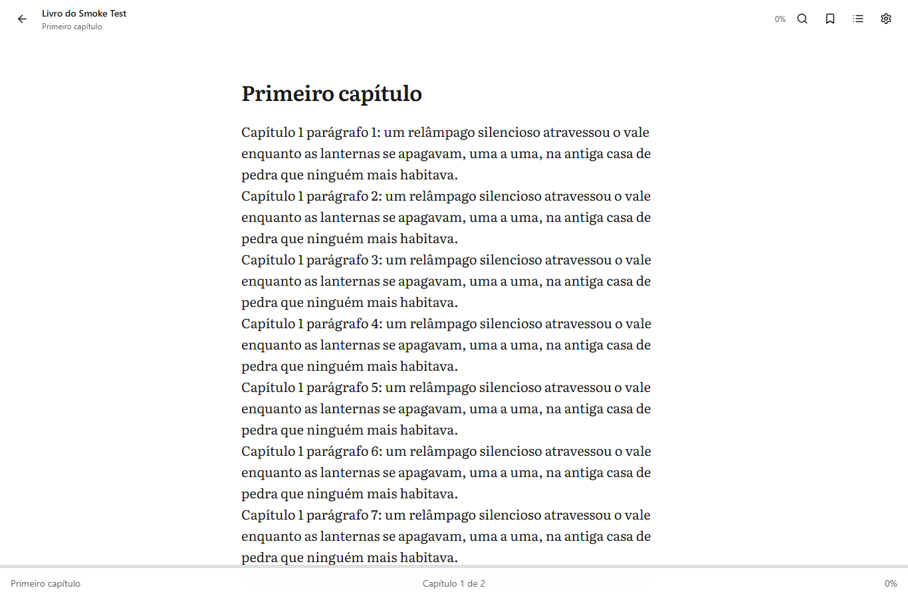
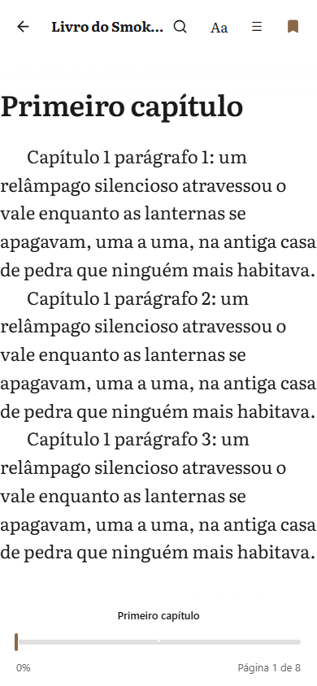
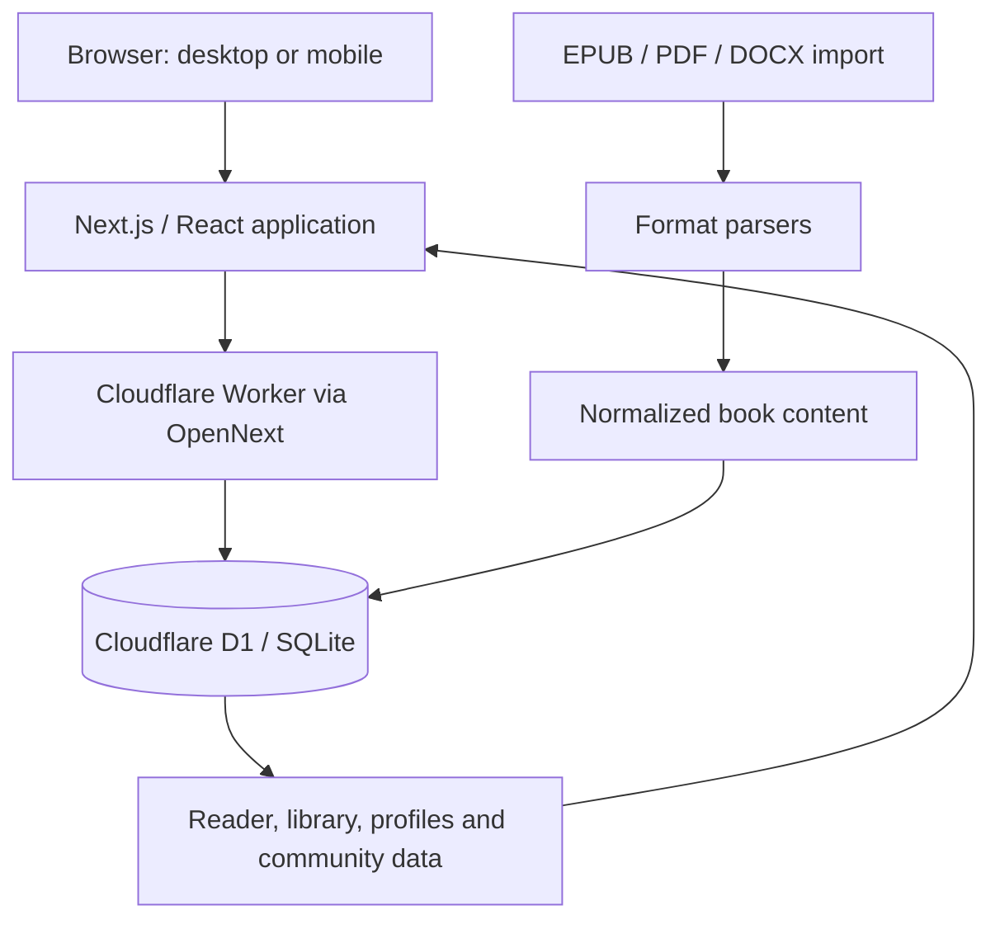

<div align="center">

# Readr 📚

**A social reading platform to import, create, organize, and enjoy books across screens.**

Read with a desktop experience inspired by [TextStack](https://github.com/mrviduus/textstack) and a mobile experience inspired by [Liseur](https://github.com/chmouel/liseur). Built with Next.js and deployed on Cloudflare Workers, with Cloudflare D1 as its database and file store.

[](https://readr.miguxl.workers.dev/)
[](LICENSE)
[](https://nextjs.org/)
[](https://workers.cloudflare.com/)

[Try the live app](https://readr.miguxl.workers.dev/) · [Report an issue](https://github.com/Miguel-bg/readr/issues) · [Source code](https://github.com/Miguel-bg/readr)

</div>

---

## Contents

- [What is Readr?](#what-is-readr)
- [Features](#features)
  - [Reading experience](#reading-experience)
  - [Personal library](#personal-library)
  - [Social reading](#social-reading)
  - [Create and publish books](#create-and-publish-books)
  - [Importing books](#importing-books)
  - [Personalization and accessibility](#personalization-and-accessibility)
- [Supported formats](#supported-formats)
- [Technology stack](#technology-stack)
- [Architecture](#architecture)
- [Project structure](#project-structure)
- [Getting started](#getting-started)
- [Cloudflare configuration and deployment](#cloudflare-configuration-and-deployment)
- [Security and data](#security-and-data)
- [Current scope](#current-scope)
- [Acknowledgements](#acknowledgements)
- [License](#license)

---

## What is Readr?

Readr is a web-based reading platform that brings together a personal ebook library, customizable reading tools, book creation, and social features.

It is designed around two reading interfaces:

- **Desktop:** a TextStack-inspired reading experience.
- **Mobile:** a Liseur-inspired reading experience.

Beyond opening books, Readr lets readers keep their place, organize books into reading states, save bookmarks and highlights, write reviews, follow other readers, and create books with chapters.

**Live application:** [readr.miguxl.workers.dev](https://readr.miguxl.workers.dev/)

## Features

### Reading experience

- Separate desktop and mobile reading interfaces, selected by a responsive reader engine.
- Desktop reads in a continuous-scroll column; mobile reads in paginated columns with tap zones and a progress scrubber.
- Chapter and table-of-contents navigation.
- In-book text search with navigation to matching content.
- Reading progress and anchor-based position tracking, so a saved position is tied to the book content rather than only a screen coordinate.
- Bookmarks with optional notes.
- Text highlights in yellow, green, blue, and pink, with optional notes.
- Text selection actions, including copy, highlight, note, dictionary lookup, and sharing.

| Desktop (TextStack-inspired) | Mobile (Liseur-inspired) |
| :---: | :---: |
|  |  |

### Personal library

- Import and manage personal books.
- Keep imported books separate from books created in Readr.
- Organize titles with reading states:
  - Saved
  - Want to read
  - Currently reading
  - Completed
- Browse the library and search by book title or author.
- Store book details such as title, author, description, cover, genre, language, publication year, publisher, and tags when available.
- Resume reading using saved progress.

### Social reading

- Reader accounts and public-facing profile information.
- Follow and unfollow other readers.
- Book reviews with a 1–5 rating and written review content.
- Like and dislike reactions on books.
- Activity records associated with readers and books.
- Community and public-library areas in the application.

### Create and publish books

- Create books separately from imported files.
- Add book information, including title, author, description, cover, genre, language, publication year, publisher, and tags.
- Write and organize chapters.
- Save a created book as a draft or publish it.
- Keep created books and their chapters associated with the account that owns them.

### Importing books

Readr currently accepts these import formats:

| Format | Parser / library | Notes |
| --- | --- | --- |
| EPUB | JSZip | EPUB archive and its internal resources are processed for reading. |
| PDF | PDF.js (`pdfjs-dist`) | PDF documents are processed for reading and text access. |
| DOCX | Mammoth | Word documents are converted into readable content. |

Imported book records can include metadata, cover information, and a table of contents when that information is available in the source document.

### Personalization and accessibility

- Six reader color themes: light, cream, sepia, gray, dark, and black.
- Reader typefaces: Literata, Georgia, Source Sans, and OpenDyslexic.
- Adjustable font size, text alignment, line spacing, and screen brightness.
- Light and dark application themes.
- Interface localization for Portuguese, English, and Spanish.

## Supported formats

| Format | Import | Reading workflow |
| --- | :---: | --- |
| EPUB | ✅ | Reflowable ebook content |
| PDF | ✅ | PDF document content |
| DOCX | ✅ | Converted document content |

Other formats such as MOBI, AZW/AZW3, CBZ/CBR, and audiobook files are **not listed as supported import formats** in the current application configuration.

Metadata and cover extraction depend on the information available in the source file. A scanned PDF without a text layer may require OCR; OCR is not documented as part of the current import pipeline.

## Technology stack

| Layer | Technology | Purpose |
| --- | --- | --- |
| Framework | Next.js 15.5 | App Router and application rendering |
| UI | React 18 + TypeScript | Component-based interface and typed application code |
| Styling | Tailwind CSS 3 | Responsive styling |
| Reader state | Zustand 5 | Reader preferences and client-side state |
| Localization | next-intl 3 | Portuguese, English, and Spanish interface messages |
| Edge runtime | Cloudflare Workers | Application runtime and deployment target |
| Next.js adapter | OpenNext for Cloudflare | Builds the Next.js application for Workers |
| Database | Cloudflare D1 (SQLite) | Application records and reading data |
| EPUB processing | JSZip | Reading EPUB package contents |
| PDF processing | PDF.js | PDF rendering and text access |
| DOCX processing | Mammoth | DOCX content conversion |
| Icons | Lucide React | Interface icons |

## Architecture

Readr is deployed as a Next.js application running on Cloudflare Workers. Cloudflare D1 is the application's database. The repository configuration does not define a separate Supabase, R2, or KV service.



### Data storage

- Relational application data is defined in [`d1/schema.sql`](d1/schema.sql).
- Imported book content is stored as JSON content chunks in `book_content`.
- File records and binary file chunks are represented by `files` and `file_chunks` tables.
- The schema separates imported books (`books`) from books created in Readr (`created_books` and `chapters`).
- Reading progress, shelves, reviews, reactions, follows, activities, bookmarks, and highlights have dedicated tables.

The schema splits larger content and files into chunks to stay within D1's per-row size constraints.

## Project structure

```text
.
├── d1/
│   └── schema.sql              # Cloudflare D1 schema
├── docs/
│   └── screenshots/            # Screenshots used by this README
├── public/
│   └── fonts/                  # Reader fonts
├── scripts/                    # Development and validation scripts
├── src/
│   ├── app/                    # Next.js routes and API handlers
│   ├── components/
│   │   ├── editor/             # Book creation and editing
│   │   ├── home/               # Home and continue-reading UI
│   │   ├── library/            # Library and shelves
│   │   ├── reader/             # Reader engine shell and shared controls
│   │   ├── reader/v2/          # TextStack and Liseur reader interfaces
│   │   └── ui/                 # Shared UI and providers
│   ├── lib/                    # Parsers, data access and reader sources
│   ├── messages/               # pt, en and es translations
│   ├── store/                  # Zustand stores
│   └── styles/                 # Application and reader styles
├── .env.example                # Local environment template
├── open-next.config.ts
├── package.json
└── wrangler.jsonc              # Workers and D1 bindings
```

## Getting started

### Prerequisites

- Node.js and npm.
- A local checkout of this repository.

### 1. Clone the repository

```bash
git clone https://github.com/Miguel-bg/readr.git
cd readr
```

### 2. Install dependencies

```bash
npm ci
```

### 3. Configure the local secret

Copy the environment template to `.dev.vars`:

**Windows PowerShell**

```powershell
Copy-Item .env.example .dev.vars
```

**macOS / Linux**

```bash
cp .env.example .dev.vars
```

Edit `.dev.vars` and set a strong local secret:

```dotenv
NEXTJS_ENV=development
JWT_SECRET=replace-with-a-long-random-secret
```

Do not commit `.dev.vars` or real secrets to Git.

### 4. Initialize the local D1 database

```bash
npx wrangler d1 execute readr --local --file=d1/schema.sql
```

### 5. Start the development server

```bash
npm run dev
```

Open [http://localhost:3000](http://localhost:3000).

### Useful development commands

| Command | Purpose |
| --- | --- |
| `npm run dev` | Start the Next.js development server |
| `npm run build` | Build the Next.js application |
| `npm run preview` | Build and preview the Cloudflare Worker locally |
| `npm run deploy` | Build with OpenNext and deploy to Cloudflare Workers |
| `npm run lint` | Run ESLint (Next.js and TypeScript rules) |
| `npm run check:reader-translations` | Check reader translation files |
| `npm run cf-typegen` | Generate Cloudflare environment types |

## Cloudflare configuration and deployment

The Cloudflare configuration lives in [`wrangler.jsonc`](wrangler.jsonc).

- Worker name: `readr`
- D1 binding: `DB`
- D1 database: `readr`
- Worker entry point: `.open-next/worker.js`
- Static assets: `.open-next/assets`

### Configure the production secret

Set the JWT signing secret through Wrangler rather than hard-coding it in the repository:

```bash
npx wrangler secret put JWT_SECRET
```

### Apply the D1 schema

For a remote database, run the schema command with `--remote`:

```bash
npx wrangler d1 execute readr --remote --file=d1/schema.sql
```

The schema uses `CREATE TABLE IF NOT EXISTS` and can be applied repeatedly for initial setup. Review schema changes carefully before applying them to a production database.

### Deploy

```bash
npm run deploy
```

Pushes to `main` also trigger an automatic build and deploy through Cloudflare Workers Builds, so merging a pull request updates the production Worker.

The production application is available at:

**[https://readr.miguxl.workers.dev/](https://readr.miguxl.workers.dev/)**

## Security and data

- Password credentials are stored as PBKDF2-derived hashes; the current configuration uses 310,000 iterations, and the derivation runs in the browser so the raw password never leaves it.
- Authentication uses signed JWTs in `HttpOnly` cookies.
- `JWT_SECRET` is configured as a Cloudflare Worker secret in production.
- The database schema associates books and created content with user accounts.
- The schema distinguishes public cover/avatar files from private book-file records.
- Account deletion is exposed in the settings interface.

Do not use production credentials, real user data, or private book files in local development examples or screenshots.

## Current scope

The repository currently configures EPUB, PDF, and DOCX imports. Features such as OCR for scanned PDFs, MOBI/AZW support, audiobook playback, external device synchronization, and ebook export should not be assumed to be available unless they are implemented and documented separately.

The live application may evolve faster than this README. Please open an issue when you find a discrepancy between the documentation and the current application.

## Acknowledgements

Readr's reading interfaces take inspiration from these open-source projects:

- [TextStack](https://github.com/mrviduus/textstack) — desktop reading experience.
- [Liseur](https://github.com/chmouel/liseur) — mobile reading experience.

Readr is an independent project and is not affiliated with either project.

## License

Readr is released under the [MIT License](LICENSE).

## Author

Created by **Miguel Braga**.

- GitHub: [@Miguel-bg](https://github.com/Miguel-bg)
- Project: [github.com/Miguel-bg/readr](https://github.com/Miguel-bg/readr)
