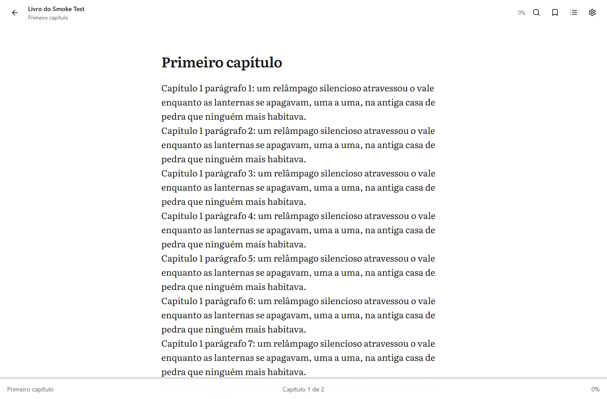
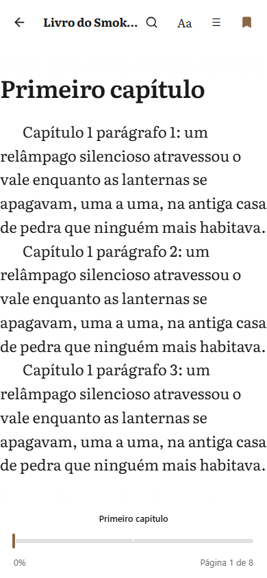
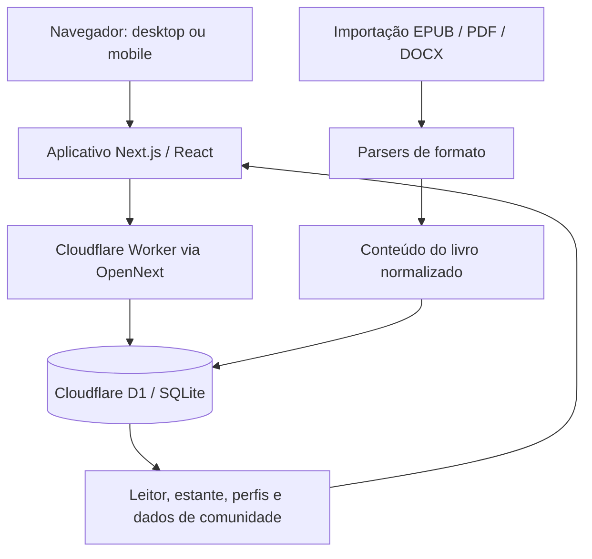

<div align="center">

# Readr 📚

**Uma plataforma social de leitura para importar, criar, organizar e aproveitar livros em qualquer tela.**

Leia com uma experiência de desktop inspirada no [TextStack](https://github.com/mrviduus/textstack) e uma experiência mobile inspirada no [Liseur](https://github.com/chmouel/liseur). Construído com Next.js e publicado no Cloudflare Workers, com Cloudflare D1 como banco de dados e armazenamento de arquivos.

[](https://readr.miguxl.workers.dev/)
[](LICENSE)
[](https://nextjs.org/)
[](https://workers.cloudflare.com/)

[English](README.md) · **Português (Brasil)**

[Testar o app ao vivo](https://readr.miguxl.workers.dev/) · [Reportar um problema](https://github.com/Miguel-bg/readr/issues) · [Código-fonte](https://github.com/Miguel-bg/readr)

</div>

---

## Sumário

- [O que é o Readr?](#o-que-é-o-readr)
- [Funcionalidades](#funcionalidades)
  - [Experiência de leitura](#experiência-de-leitura)
  - [Biblioteca pessoal](#biblioteca-pessoal)
  - [Leitura social](#leitura-social)
  - [Criar e publicar livros](#criar-e-publicar-livros)
  - [Importação de livros](#importação-de-livros)
  - [Personalização e acessibilidade](#personalização-e-acessibilidade)
- [Formatos suportados](#formatos-suportados)
- [Stack tecnológica](#stack-tecnológica)
- [Arquitetura](#arquitetura)
- [Estrutura do projeto](#estrutura-do-projeto)
- [Começando](#começando)
- [Configuração e deploy no Cloudflare](#configuração-e-deploy-no-cloudflare)
- [Segurança e dados](#segurança-e-dados)
- [Escopo atual](#escopo-atual)
- [Agradecimentos](#agradecimentos)
- [Licença](#licença)

---

## O que é o Readr?

O Readr é uma plataforma de leitura web que reúne uma biblioteca pessoal de ebooks, ferramentas de leitura customizáveis, criação de livros e recursos sociais.

Ele é organizado em torno de duas interfaces de leitura:

- **Desktop:** uma experiência de leitura inspirada no TextStack.
- **Mobile:** uma experiência de leitura inspirada no Liseur.

Além de abrir livros, o Readr permite guardar o ponto de leitura, organizar livros por estados de leitura, salvar marcadores e grifos, escrever avaliações, seguir outros leitores e criar livros com capítulos.

**Aplicação ao vivo:** [readr.miguxl.workers.dev](https://readr.miguxl.workers.dev/)

## Funcionalidades

### Experiência de leitura

- Interfaces de leitura separadas para desktop e mobile, escolhidas por um engine responsivo.
- No desktop a leitura acontece em uma coluna com rolagem contínua; no mobile a leitura é paginada em colunas, com zonas de toque e barra de progresso.
- Navegação por capítulos e sumário.
- Busca de texto dentro do livro, com navegação direta até os resultados.
- Progresso de leitura e registro de posição por âncoras — a posição salva fica amarrada ao conteúdo do livro, e não a uma coordenada de tela.
- Marcadores com nota opcional.
- Grifos de texto em amarelo, verde, azul e rosa, com nota opcional.
- Ações sobre a seleção de texto, incluindo copiar, grifar, criar nota, consulta de dicionário e compartilhar.

| Desktop (inspirado no TextStack) | Mobile (inspirado no Liseur) |
| :---: | :---: |
|  |  |

### Biblioteca pessoal

- Importar e gerenciar livros pessoais.
- Manter os livros importados separados dos livros criados no Readr.
- Organizar títulos por estados de leitura:
  - Salvos
  - Quero ler
  - Lendo
  - Lidos
- Navegar pela estante e buscar por título ou autor.
- Guardar detalhes como título, autor, descrição, capa, gênero, idioma, ano de publicação, editora e tags, quando disponíveis.
- Retomar a leitura a partir do progresso salvo.

### Leitura social

- Contas de leitor e informações públicas de perfil.
- Seguir e deixar de seguir outros leitores.
- Avaliações de livros com nota de 1 a 5 e texto escrito.
- Reações de like e dislike em livros.
- Registros de atividade associados a leitores e livros.
- Áreas de comunidade e biblioteca pública no aplicativo.

### Criar e publicar livros

- Criar livros separadamente dos arquivos importados.
- Adicionar informações do livro, incluindo título, autor, descrição, capa, gênero, idioma, ano de publicação, editora e tags.
- Escrever e organizar capítulos.
- Salvar o livro como rascunho ou publicá-lo.
- Manter os livros criados (e seus capítulos) associados à conta que os criou.

### Importação de livros

O Readr aceita atualmente estes formatos de importação:

| Formato | Parser / biblioteca | Observações |
| --- | --- | --- |
| EPUB | JSZip | O pacote EPUB e seus recursos internos são processados para leitura. |
| PDF | PDF.js (`pdfjs-dist`) | Documentos PDF são processados para leitura e acesso ao texto. |
| DOCX | Mammoth | Documentos Word são convertidos em conteúdo legível. |

Os registros de livros importados podem incluir metadados, informações de capa e um sumário, quando essas informações existem no documento de origem.

### Personalização e acessibilidade

- Seis temas de cor no leitor: claro, creme, sépia, cinza, escuro e preto.
- Fontes do leitor: Literata, Georgia, Source Sans e OpenDyslexic.
- Ajuste de tamanho de fonte, alinhamento do texto, espaçamento entre linhas e brilho da tela.
- Temas claro e escuro do aplicativo.
- Interface localizado em português, inglês e espanhol.

## Formatos suportados

| Formato | Importação | Fluxo de leitura |
| --- | :---: | --- |
| EPUB | ✅ | Conteúdo de ebook reaproveitável |
| PDF | ✅ | Conteúdo de documento PDF |
| DOCX | ✅ | Conteúdo de documento convertido |

Outros formatos como MOBI, AZW/AZW3, CBZ/CBR e audiolivros **não estão listados como formatos de importação suportados** na configuração atual do aplicativo.

A extração de metadados e capa depende das informações presentes no arquivo de origem. Um PDF escaneado sem camada de texto pode precisar de OCR; o OCR não faz parte do pipeline de importação documentado.

## Stack tecnológica

| Camada | Tecnologia | Uso |
| --- | --- | --- |
| Framework | Next.js 15.5 | App Router e renderização do aplicativo |
| UI | React 18 + TypeScript | Interface baseada em componentes e código tipado |
| Estilos | Tailwind CSS 3 | Estilização responsiva |
| Estado do leitor | Zustand 5 | Preferências do leitor e estado no cliente |
| Localização | next-intl 3 | Mensagens de interface em português, inglês e espanhol |
| Runtime de borda | Cloudflare Workers | Runtime e alvo de deploy do aplicativo |
| Adaptador Next.js | OpenNext for Cloudflare | Empacota o aplicativo Next.js para Workers |
| Banco de dados | Cloudflare D1 (SQLite) | Registros do aplicativo e dados de leitura |
| Leitura de EPUB | JSZip | Leitura do conteúdo do pacote EPUB |
| Leitura de PDF | PDF.js | Renderização e extração de texto de PDFs |
| Leitura de DOCX | Mammoth | Conversão de conteúdo DOCX |
| Ícones | Lucide React | Ícones da interface |

## Arquitetura

O Readr é publicado como um aplicativo Next.js rodando no Cloudflare Workers. O Cloudflare D1 é o banco de dados do aplicativo. A configuração do repositório não define nenhum serviço separado de Supabase, R2 ou KV.



### Armazenamento de dados

- Os dados relacionais do aplicativo são definidos em [`d1/schema.sql`](d1/schema.sql).
- O conteúdo dos livros importados é gravado como chunks JSON na tabela `book_content`.
- Registros de arquivos e chunks binários ficam nas tabelas `files` e `file_chunks`.
- O schema separa os livros importados (`books`) dos livros criados no Readr (`created_books` e `chapters`).
- Progresso de leitura, estantes, avaliações, reações, follows, atividades, marcadores e grifos têm tabelas dedicadas.

O schema divide conteúdo e arquivos grandes em chunks para respeitar os limites de tamanho por linha do D1.

## Estrutura do projeto

```text
.
├── d1/
│   └── schema.sql              # Schema do Cloudflare D1
├── docs/
│   └── screenshots/            # Capturas de tela usadas neste README
├── public/
│   └── fonts/                  # Fontes do leitor
├── scripts/                    # Scripts de desenvolvimento e validação
├── src/
│   ├── app/                    # Rotas e handlers de API do Next.js
│   ├── components/
│   │   ├── editor/             # Criação e edição de livros
│   │   ├── home/               # Home e "continue lendo"
│   │   ├── library/            # Estante e prateleiras
│   │   ├── reader/             # Shell do engine de leitura e controles compartilhados
│   │   ├── reader/v2/          # Interfaces de leitura TextStack e Liseur
│   │   └── ui/                 # UI compartilhada e providers
│   ├── lib/                    # Parsers, acesso a dados e fontes do leitor
│   ├── messages/               # Traduções pt, en e es
│   ├── store/                  # Stores Zustand
│   └── styles/                 # Estilos do aplicativo e do leitor
├── .env.example                # Template de ambiente local
├── open-next.config.ts
├── package.json
└── wrangler.jsonc              # Bindings de Workers e D1
```

## Começando

### Pré-requisitos

- Node.js e npm.
- Um checkout local deste repositório.

### 1. Clone o repositório

```bash
git clone https://github.com/Miguel-bg/readr.git
cd readr
```

### 2. Instale as dependências

```bash
npm ci
```

### 3. Configure o segredo local

Copie o template de ambiente para `.dev.vars`:

**Windows PowerShell**

```powershell
Copy-Item .env.example .dev.vars
```

**macOS / Linux**

```bash
cp .env.example .dev.vars
```

Edite o `.dev.vars` e defina um segredo local forte:

```dotenv
NEXTJS_ENV=development
JWT_SECRET=troque-por-um-segredo-forte-e-longo
```

Não faça commit de `.dev.vars` nem de segredos reais no Git.

### 4. Inicialize o banco D1 local

```bash
npx wrangler d1 execute readr --local --file=d1/schema.sql
```

### 5. Inicie o servidor de desenvolvimento

```bash
npm run dev
```

Abra [http://localhost:3000](http://localhost:3000).

### Comandos úteis de desenvolvimento

| Comando | Uso |
| --- | --- |
| `npm run dev` | Inicia o servidor de desenvolvimento do Next.js |
| `npm run build` | Compila o aplicativo Next.js |
| `npm run preview` | Compila e roda o preview do Cloudflare Worker localmente |
| `npm run deploy` | Compila com OpenNext e publica no Cloudflare Workers |
| `npm run lint` | Roda o lint configurado do Next.js |
| `npm run check:reader-translations` | Confere os arquivos de tradução do leitor |
| `npm run cf-typegen` | Gera os tipos do ambiente Cloudflare |

## Configuração e deploy no Cloudflare

A configuração do Cloudflare fica em [`wrangler.jsonc`](wrangler.jsonc).

- Nome do Worker: `readr`
- Binding D1: `DB`
- Banco D1: `readr`
- Entry point do Worker: `.open-next/worker.js`
- Assets estáticos: `.open-next/assets`

### Configure o segredo de produção

Defina o segredo de assinatura do JWT pelo Wrangler, em vez de gravá-lo no repositório:

```bash
npx wrangler secret put JWT_SECRET
```

### Aplique o schema do D1

Para o banco remoto, rode o comando de schema com `--remote`:

```bash
npx wrangler d1 execute readr --remote --file=d1/schema.sql
```

O schema usa `CREATE TABLE IF NOT EXISTS` e pode ser aplicado múltiplas vezes no setup inicial. Revise mudanças de schema com cuidado antes de aplicá-las em um banco de produção.

### Deploy

```bash
npm run deploy
```

Pushes na `main` também disparam build e deploy automáticos pelo Cloudflare Workers Builds — mesclar um pull request já atualiza o Worker de produção.

O aplicativo de produção está disponível em:

**[https://readr.miguxl.workers.dev/](https://readr.miguxl.workers.dev/)**

## Segurança e dados

- As senhas são guardadas como hashes derivados por PBKDF2; a configuração atual usa 310.000 iterações, e a derivação roda no navegador — a senha em claro nunca sai dele.
- A autenticação usa JWTs assinados em cookies `HttpOnly`.
- O `JWT_SECRET` é configurado como secret do Worker no Cloudflare em produção.
- O schema do banco associa livros e conteúdo criado às contas dos usuários.
- O schema distingue arquivos públicos (capas/avatares) de registros privados de arquivo do livro.
- A exclusão da conta está disponível na tela de configurações.

Não use credenciais de produção, dados reais de usuários nem arquivos privados de livros em exemplos locais de desenvolvimento ou screenshots.

## Escopo atual

O repositório configura atualmente a importação de EPUB, PDF e DOCX. Funcionalidades como OCR para PDFs escaneados, suporte a MOBI/AZW, reprodução de audiolivros, sincronização com dispositivos externos e exportação de ebooks não devem ser presumidas como disponíveis, a menos que estejam implementadas e documentadas separadamente.

O aplicativo ao vivo pode evoluir mais rápido que este README. Quando encontrar uma discrepância entre a documentação e o aplicativo atual, abra uma issue.

## Agradecimentos

As interfaces de leitura do Readr se inspiram nestes projetos open-source:

- [TextStack](https://github.com/mrviduus/textstack) — experiência de leitura no desktop.
- [Liseur](https://github.com/chmouel/liseur) — experiência de leitura no mobile.

O Readr é um projeto independente e não está afiliado a nenhum deles.

## Licença

O Readr é distribuído sob a [Licença MIT](LICENSE).

## Autor

Criado por **Miguel Braga**.

- GitHub: [@Miguel-bg](https://github.com/Miguel-bg)
- Projeto: [github.com/Miguel-bg/readr](https://github.com/Miguel-bg/readr)
